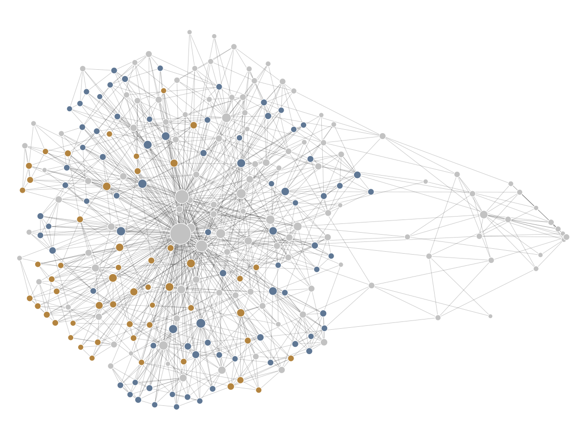

<h1 align="center">Fundamentals Kasten</h1>

<p align="center">
  <b>The software engineering fundamentals that outlast every framework, as a Zettelkasten you fill in yourself.</b><br>
  130 concepts · 19 builds · 38 sources · a 28-week program. Every note ships empty, on purpose.
</p>

<p align="center">
  <a href="https://github.com/hippync/fundamentals-kasten/generate"></a>
  <a href="LICENSE"></a>
  
  
  
  
</p>

<p align="center">
  <a href="#quick-start">Quick start</a> ·
  <a href="#why-this-exists">Why</a> ·
  <a href="#how-it-works">How it works</a> ·
  <a href="#whats-inside">What's inside</a> ·
  <a href="#contributing">Contributing</a> ·
  <a href="MOC.md">Map of contents</a>
</p>

<p align="center">
  <picture>
    <source media="(prefers-color-scheme: dark)" srcset="docs/graph-dark.svg">
    
  </picture>
</p>

<p align="center">
  <sub>
    252 notes · 1,125 connections · not one word of explanation in any of them.<br>
    Blue is the Systems ladder, amber the AI ladder, grey the scaffolding that holds them together.<br>
    Drawn from the actual wikilinks by <a href="scripts/graph.py"><code>scripts/graph.py</code></a>. A map of how the notes connect, not an embedding space.
  </sub>
</p>

---

## Highlights

- **Two ladders, 130 atomic concepts.** A Systems ladder (S01–S10: the machine, concurrency, networking, data, distributed systems, design, security, operations, toolchain, debugging) and an AI ladder (A1–A9: model internals through the economics of intelligence), plus methodologies and senior multipliers.
- **Every concept opens with *Predict the failure*.** Not "can I define this" but "what breaks in production when this is missing or misunderstood".
- **19 build-to-learn exercises.** A raw-socket HTTP server, a tiny GPT, an idempotent job queue, an attack on your own agent. Each one names the failure to cause on purpose.
- **38 tier-ranked sources**, with chapter pointers and the free ones marked.
- **A 28-week program** in two-week blocks, ending in a [capstone](capstone/README.md) you write rather than sit.
- **A status ladder that goes past "I read it":** 🌱 stub → 🌿 drafted → 🌳 explained → 🔥 tested.
- **Plain markdown, no lock-in.** YAML frontmatter and `[[wikilinks]]`. Best in Obsidian, fine in Logseq, Foam, VS Code or `grep`.

## Quick start

1. Click **[Use this template](https://github.com/hippync/fundamentals-kasten/generate)**. You get your own repo with no shared history, and your kasten should start diverging from this one straight away.
2. Clone it and open the folder as an [Obsidian](https://obsidian.md) vault.
3. Write [`08-decisions/ADR-0001 — Choosing the primary language`](08-decisions/). It's one blank page, and doing it first keeps you from spending week three comparing languages instead of learning one.
4. Open [`07-program/Block 01-02 — The machine.md`](07-program/) and start.

Optionally, watch the graph fill in as you go (Python standard library only, nothing to install):

```bash
python scripts/graph.py
```

## Why this exists

You can ship features. You can prompt a model into a working implementation. And you may suspect you're getting further from the machine every year, not closer: you'd struggle to explain why the code you just merged is fast, or how it will fail.

That suspicion is usually right, and another framework won't fix it. What fixes it is **investing by half-life**:

| Knowledge type | Half-life | Example |
|---|---|---|
| Framework / library API | ~3 years | The current React data-fetching pattern |
| Language | ~10 years | Go, C#, Python |
| Systems concept | ~40 years | Cache locality, ACID, TCP, coupling |
| Reasoning skill | Career-length | Decomposition, failure analysis, tradeoff judgment |

Most learning time goes on the top row, and that's the row a language model handles best. The bottom two rows compound, and they're where a model needs a supervisor who can tell whether its answer is right. This kasten covers those two rows. The filter is written up in [The noise filter](00-meta/The%20noise%20filter.md).

### Why every note is empty

> **Read this before you open an issue asking where the content is.**

This repo ships scaffolding: each concept's name, the rung it sits on, the question it answers, the source to open and what it links to. It doesn't ship explanations.

A kasten full of correct-sounding paragraphs you didn't write is worse than no kasten. It gives you recognition, and recognition feels exactly like knowledge until the moment you need to use it. Every concept note has a section called **In my own words**. That section is the only part of this repo with any value, and only you can write it. If that isn't the trade you want, you want a textbook, and [`05-sources/`](05-sources/) lists excellent ones.

## How it works

The structure follows Sönke Ahrens' *How to Take Smart Notes*, adapted for technical material:

- **Fleeting notes** are whatever you scribble while reading. They live in your own inbox, not here, and you throw them away.
- **Literature notes** go one per source in `05-sources/`: what the source claimed, in your words, with a chapter you can point at.
- **Permanent notes** hold one idea each, written from scratch and linked to the notes it bears on. These are the 130 concept notes, and writing them is the whole exercise.

Ahrens' test for a permanent note is whether a stranger could follow it months later. The test here is harder:

> **You understand a system when you can predict how it breaks.**

That's why the status ladder has four rungs, not two:

| | `status` | Means |
|---|---|---|
| 🌱 | `stub` | Generated scaffolding. You haven't touched it. |
| 🌿 | `drafted` | You read a source and filled in the body. |
| 🌳 | `explained` | You wrote *In my own words* with the book closed. |
| 🔥 | `tested` | You predicted a failure mode and then caused it, or built something that depends on it. |

Don't aim for a whole repo of 🌳, because that's collecting. Aim for every concept in your current block at 🌳 and that block's build at 🔥.

The full argument, including where this deliberately departs from Ahrens, is in [Methodology](00-meta/Methodology.md). The weekly loop is in [How to use this kasten](00-meta/How%20to%20use%20this%20kasten.md).

## What's inside

```
00-meta/                methodology, the note contract, 15 operating principles, status board
01-systems/             S01–S10, the Systems ladder                         (70 concepts)
02-ai/                  A1–A9, the AI ladder                                (43 concepts)
03-methodologies/       Waterfall through XP, TDD, CI and AI-assisted work  (13)
04-senior-multipliers/  ADRs, estimation, saying no with a reason, writing  (4)
05-sources/             38 sources, tier-ranked, free ones marked
06-builds/              19 build-to-learn exercises: the part that isn't reading
07-program/             a 28-week sequence in two-week blocks
08-decisions/           ADR-0001 is blank, and writing it is your first task
capstone/               the exam
_templates/             note templates
docs/                   the graph above
scripts/                graph.py redraws the graph · reset.py restores every note to stub
```

Start at the **[Map of contents](MOC.md)**. The notes themselves use `[[wikilinks]]`, so they read best in Obsidian. On GitHub, wikilinks and `> [!question]` callouts render as plain text; `README.md` and `MOC.md` use ordinary relative links so you can still find your way around from the web.

## Reading the graph

The graph is generated, not screenshotted. Re-run `python scripts/graph.py` to redraw both SVGs from your own links, or `python scripts/graph.py --stats` for the numbers alone. The layout is seeded, so a diff means the links really changed. Two things to watch:

- **Orphans.** A note that nothing links to is one you filed and never used. A rising orphan count is the earliest sign you've gone back to collecting.
- **Hubs.** In a fresh copy the biggest nodes are the indexes, because indexes are all there is. Once you've worked in a kasten, concepts start to outrank them.

## Contributing

Contributions are taken in a narrower range than most repos, and **pull requests that fill in notes are declined**. Your understanding written down for someone else is exactly what this repo exists to prevent. Fork it and fill in your own copy.

These are genuinely wanted, and each one has an issue form:

- 🐛 [Scaffolding errors](https://github.com/hippync/fundamentals-kasten/issues/new?template=1-scaffolding-error.yml): a concept on the wrong rung, a broken wikilink, bad frontmatter
- 🧩 [A missing concept](https://github.com/hippync/fundamentals-kasten/issues/new?template=2-missing-concept.yml) or a thin rung (A8 has one concept and could use more)
- 📚 [A better source](https://github.com/hippync/fundamentals-kasten/issues/new?template=3-better-source.yml), with the chapter number
- 🔨 [A better build](https://github.com/hippync/fundamentals-kasten/issues/new?template=4-build.yml): what to make, the failure to cause, how you'd know it worked

Read [CONTRIBUTING.md](CONTRIBUTING.md) before opening a PR. It covers the house rules, including **don't regenerate the graph SVGs** in a PR.

## Support

- **Not sure whether it's a bug or the design?** [Open an issue](https://github.com/hippync/fundamentals-kasten/issues/new/choose) and ask. That's cheaper for both of us than a PR that ends up closed.
- **Filled yours in properly?** I'd genuinely like to see it. Open an issue with a link.

## Provenance and license

The concept inventory, the two ladders, the question lists, the half-life table, the build briefs and the 28-week sequence come from *The Fundamentals Reset (Field Manual, Edition 2026)*, which I wrote with AI assistance. The scaffolding was generated from it and then edited by hand.

Notes and prose are under [CC BY-SA 4.0](LICENSE), and scripts are MIT. Attribution is appreciated, and a link back is plenty.
